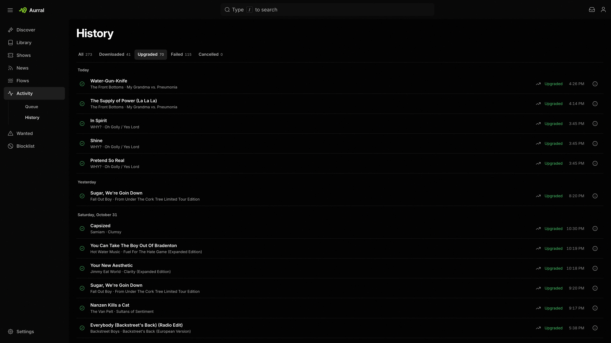

**Activity** shows the work that Aurral does for you. It has two views:

- **Queue** lists album requests, queued and active downloads, playlist imports, and tracks that wait for your review.
- **History** lists finished, denied, and failed work.

**Wanted** lists Aurral tracks that need more work. It has two views, shown as tabs in Activity:

- **Missing** lists tracks whose download failed or was cancelled.
- **Cutoff unmet** lists tracks with files below your quality cutoff.

To see the details of any row in Activity or Wanted, select its info action.

## Queue

**Queue** shows active work, including playlist imports that have not started yet. A track stays in the queue when it waits for your decision, for example when its duration or identity is unclear.

A quality upgrade searches for a better file of a track you already have, so that track can appear in the queue again. Its row shows a rising arrow before the status. Hover the arrow, or open the row's info, to see the quality it replaces. Your current file stays until the upgrade finishes.

For a track that Aurral downloads for an album, select **Open** to go to the album page. That page shows the download state and lets you cancel or retry.

### Album downloads

When Aurral looks for two or more missing tracks of a Library album on one release, Activity shows those tracks in one album row. Expand the row to see each track's status and review controls.

- The row shows how many tracks are ready.
- The row stays in **Queue** while any track is active or waits for review.
- In **History**, the row shows **Completed** only when every track is ready. A failed or missing track leaves the album incomplete.

If the release leaves tracks unfilled, Aurral first tries the next ranked folder or release for them, and then the next download source that can supply the release. If Aurral then falls back to downloading tracks one by one, those tracks stay in the same album row. The info action shows the reason for the fallback and the download sources. Other requests show one row for each track.

### Review a track

Aurral holds a download for review when the file has the requested title but its duration or artist credit is a little off. A file from Soulseek, Usenet, deemix, or yt-dlp waits while Aurral tries the other results and download sources, and goes to review only if none of them verifies. The file stays with its track through a restart, and while an album download that failed starts again. If you deny it, Aurral searches for the track again from the start, its album's release included. Another song by the same artist is never held for review, and neither is an automatic upgrade: Aurral drops a file it cannot verify and keeps the one you have. Flow tracks never wait for review either, since you can't judge a recommendation you haven't heard. Aurral drops a flow file it cannot verify, and the track fails if no other result verifies.

Each review row shows the requested track, artist, and album, the path of the downloaded file, the match scores, and the duration. Preview the track, then approve or deny it.

Approving moves the file into the Library. Denying deletes it and searches again without that file. Removing a playlist, an album, or a track that waits for review deletes its file too. Aurral never deletes a file in the Library folder or a read-only folder this way, for example one that deemix saved there.

A track that waits longer than three days is denied, and Aurral searches again without its file.

## History

**History** shows finished, denied, and failed work.

When an album download fails, use **Retry** on the album page.

Aurral stores who requested each album. Activity can show the requester, and other tools can filter requests by user.

## Wanted

**Wanted** includes every Library track that Aurral manages, the tracks in your playlists, and the tracks in the flows that you can open. It leaves out [unmonitored tracks](/using/library/#albums-and-tracks).

**Missing** lists the same tracks that a playlist page marks **Missing**: downloads that failed and downloads that were cancelled. It leaves out:

- Tracks of an album request that you cancelled. Request the album again to search for them.
- Tracks saved without a download, which a playlist page marks **Not downloaded**.

- To search again for one missing track, select **Re-search track** on its row.
- To search for a better file for one track, select **Search for upgrade** on its row in **Cutoff unmet**.
- To search for every track in the current filter, select **Search all**.

A row in **Cutoff unmet** changes to **Upgrade queued** at once, and keeps that state after a page refresh. Follow the searches in **Queue** and their results in **History**.

### Choose a download yourself

Automatic search picks a result for you. When it picks the wrong one, or none, you can choose the file yourself.

1. In **Wanted > Missing**, select **Choose a download manually** on a track.
2. In **Download client**, select a client. The list shows the configured clients: Soulseek, Tidarr, deemix, yt-dlp, qBittorrent, Usenet, and download source plugins. Usenet, Tidarr, qBittorrent, and plugins that download only albums list albums. Aurral downloads the album you choose and imports the track from it.
3. Select **Search**. Aurral shows up to 100 results from that client.
4. Select one result, then select **Download selected**.

To replace a finished track in a flow or static playlist, right-click it and select **Re-search > Manual**. The same window opens.

A manual choice works differently from an automatic search:

- Aurral downloads only the result that you chose. If that download fails, the job fails. Aurral does not try other results or other clients.
- Aurral does not check the title, artist, album, or duration of the file.
- Aurral still requires readable audio with a known quality. It accepts quality tiers that your profile turns off.
- Search results expire after 10 minutes. If they expire, search again.

### Use a file you have

When you already have the file for a missing track, use it instead of downloading the track again.

1. In **Wanted > Missing**, select **Use a file you have** on a track. In a static playlist or flow, right-click a **Missing** or **Not downloaded** track and select **Use a file you have**.
2. Choose where the file is:
   - **In the Library**: Aurral searches the Library for the track's artist and title. Change the words and select **Search** to look for something else. Files whose title, artist, or album match more of the words come first, so a file under a slightly different name still shows up. Select a file, then select **Link file**.
   - **File on disk** (admins only): browse to an audio file, or paste its full path and select **Use path**. A path as a download client sees it works when a path mapping translates it. Then select **Import file**.

A linked Library file stays where it is. Aurral treats it as a reused file, so removing the track or its playlist does not delete it.

An imported file is copied into the Library like a download, named and tagged for the track. Album art in the same folder, such as `cover.jpg`, is copied into the track's Library folder too, unless that folder already has an image with the same name. A folder with more than 10 images is treated as not being an album folder, and its images are not copied. The originals are not changed or moved. Aurral checks that the file is readable audio with a known quality, but not that its title or artist match, as with a manual download.

The browser shows the storage paths Aurral can browse, such as `/data`. To browse another folder, such as another app's music folder, mount it into Aurral and add it to the `FILE_BROWSE_ROOTS` environment variable, or paste the file's path.

The track is available at once and Aurral stops searching for it. In a playlist, a track without its own artwork or an online album cover shows the cover of its Library album, such as the album folder's `cover.jpg` or the art in the file.

## Download client setup

See [yt-dlp](/integrations/ytdlp/), [slskd](/integrations/slskd/), [Tidarr](/integrations/tidarr/), [deemix](/integrations/deemix/), and [Usenet](/integrations/usenet/).
